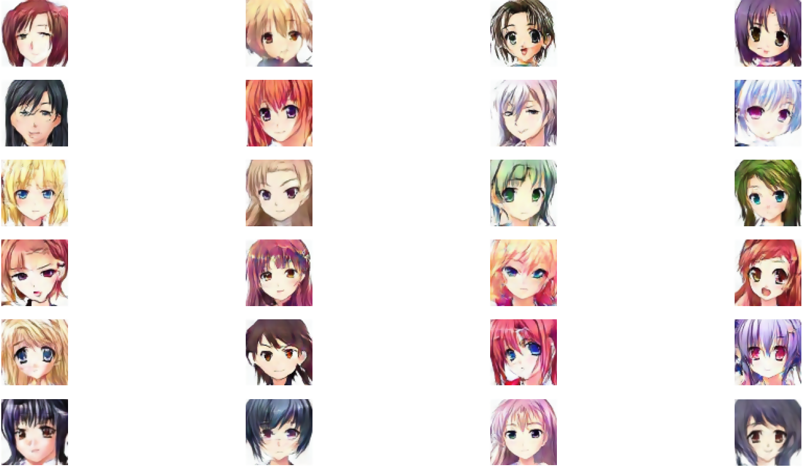
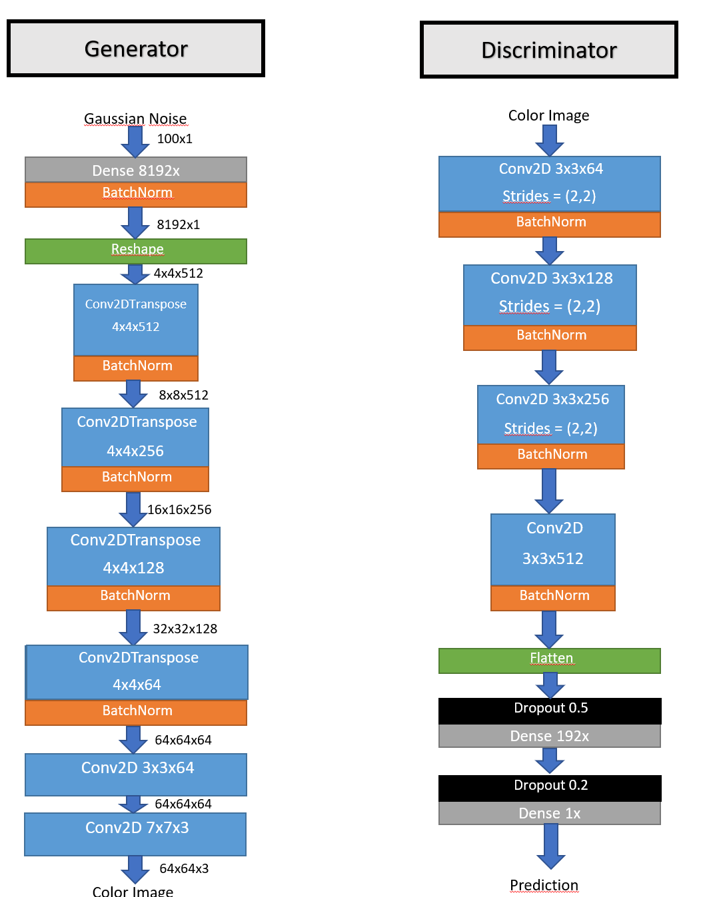

# GANime
DCGAN to generate anime-like faces. The training set used can be found [here](https://www.kaggle.com/splcher/animefacedataset).
<br>
This is an example of a batch of 24 images generated by the convolutional network. Every image has a resolution of 64x64.
<br>



# Architecture
These are the architectures chosen for the generator and the discriminator:

<br>


# Usage
The code uses [Keras 3](https://keras.io), which runs on TensorFlow or PyTorch (the JAX backend is not supported by the custom training step). Install the requirements plus one backend and select it with the `KERAS_BACKEND` environment variable:

```
pip install -r requirements.txt
pip install torch                  # or tensorflow
set KERAS_BACKEND=torch            # PowerShell: $env:KERAS_BACKEND="torch"; Linux/macOS: export KERAS_BACKEND=torch
```

Native Windows TensorFlow (> 2.10) has no GPU support, so PyTorch (CUDA build) is the easiest way to train on a Windows GPU.

| File | Purpose |
|------|---------|
| `download_dataset.py` | Downloads the dataset from Kaggle into `images/` (needs [Kaggle credentials](https://github.com/Kaggle/kaggle-api#api-credentials)) |
| `train_generator.py` | Trains the GAN |
| `test_generator.py` | Shows (or saves with `--save`) a grid of generated faces |
| `evaluate.py` | Compares generators with FID, KID, precision and recall |
| `models.py`, `data.py` | Model definitions and dataset helpers |

## Training
Download the dataset with `download_dataset.py`, or manually from [Kaggle](https://www.kaggle.com/splcher/animefacedataset), so that all the images are in the folder `images/`. Then run:

```
python train_generator.py
```

- Images smaller than 64x64 are skipped (57,236 of the 63,565 images are used). The first run resizes and caches the dataset in `images/dataset_64.npy`, which takes several minutes.
- The default is 200 epochs with batch size 64. On a RTX 2070 an epoch takes about 5-6 minutes, so the whole training takes around 18-20 hours. See `python train_generator.py --help` for the options (epochs, batch size, output folders).
- After every epoch a grid of generated faces is saved in `results/`. Every 10 epochs a generator checkpoint is saved in `checkpoints/`. At the end the generator is saved in `trained_generator.keras`.
- The hyperparameters (noise schedule, learning rates of generator and discriminator) are constants at the top of `train_generator.py`.

## Testing a generator
```
python test_generator.py --model trained_generator.keras
```
It displays a grid of generated faces (6 rows by 4 columns by default, see `--rows` and `--cols`).

Generators saved by the old Keras 2 version of the project (`.h5`) can still be loaded:
```
python test_generator.py --model trained_generator.h5 --bgr
```
(`--bgr` is needed because the old script trained on OpenCV's BGR images.)

## Evaluating generators
```
python evaluate.py "checkpoint models/anime_generator_epoch200.h5" checkpoints/anime_generator_epoch100.keras
```
Any number of generators (`.keras`, or the old `.h5`) can be compared. 10,000 real images (taken from the training set) and 10,000 generated images, always from the same latent vectors, are embedded with InceptionV3 (Keras ImageNet weights, images upscaled to 299x299). Features are cached in `images/`, so adding a model to a comparison only computes the new one. The metrics are:

* **FID** (Fréchet distance between the Gaussians fitted on the two sets of features) and **KID** (unbiased MMD with a polynomial kernel): how close the two distributions are. Lower is better.
* **Precision** and **recall** (Kynkäänniemi et al. 2019): the fraction of generated images that fall inside the support of the real ones (quality), and the fraction of real images that fall inside the support of the generated ones (coverage). The support is the union of hyperspheres, with a radius equal to the distance from the k-th nearest neighbour. They are computed for several values of k (3, 5, 10, 20 by default, see `--k`): the larger k is, the larger the spheres and the higher both values.

The absolute values depend on the network and on the image size, so they can only be compared with the ones obtained in the same way. For reference, two halves of the dataset compared with each other (5,000 vs 5,000 images) give FID 5.1, KID ≈ 0 and precision/recall of 0.68/0.68 (k=3), 0.77/0.76 (k=5), 0.86/0.85 (k=10), 0.92/0.92 (k=20).

# Results
The old Keras 2 version was trained for 200 epochs (noise standard deviation starting from 0.6 and decreasing by 0.02 per epoch). The Keras 3 version was trained for 20 epochs, with the noise starting from 0.7 and decreasing by 0.05 per epoch. These are single training runs, so differences of some points of FID are within the run-to-run variability of GANs, and the noise schedules are not the same.

| Generator | FID | KID ×10³ | P/R (k=3) | P/R (k=10) | P/R (k=20) |
|---|---|---|---|---|---|
| Keras 2, epoch 10 | 240.2 | 292.8 | 0.000 / 0.000 | 0.000 / 0.000 | 0.000 / 0.000 |
| Keras 3, epoch 10 | 288.8 | 351.1 | 0.000 / 0.000 | 0.000 / 0.000 | 0.001 / 0.000 |
| Keras 2, epoch 20 | 186.3 | 212.6 | 0.004 / 0.000 | 0.022 / 0.000 | 0.044 / 0.000 |
| Keras 3, epoch 20 | 168.2 | 185.2 | 0.024 / 0.000 | 0.081 / 0.000 | 0.142 / 0.000 |
| Keras 2, epoch 200 | 106.9 | 107.8 | 0.054 / 0.004 | 0.147 / 0.019 | 0.213 / 0.045 |
| *Real vs real* | *5.1* | *≈ 0* | *0.68 / 0.68* | *0.86 / 0.85* | *0.92 / 0.92* |

The main factor is the length of the training: even after 200 epochs the generated images are far from the real ones in the Inception feature space (FID 107), and the recall is low.

# Strategies for a stable training
For a stable GAN training, I combined different strategies that are known to improve GAN training. I took inspiration from this extremely useful guide [https://github.com/soumith/ganhacks](https://github.com/soumith/ganhacks).
These are the implemented strategies:
* Input images are normalized between -1 and 1
* The last layer of the generator uses Tanh as the activation function
* The loss function for the generator is `-log(D)` instead of `log(1-D)` (This is achieved by training the generator with the label of real images on the generated ones)
* Input noise is Gaussian, not Uniform
* The discriminator is trained with a batch of only real images, then with a batch of only fake images
* <b>Added Gaussian Noise to the Discriminator's inputs:</b> the initial noise standard deviation is very high (0.7 by default) and decreases linearly during training by 0.05 per epoch until reaching zero (`NOISE_START`, `NOISE_DECAY` in `train_generator.py`). It makes the training much more stable because it slows down the initial training phase, especially for the discriminator. When the noise is strong, the fine details are unrecognizable and both generator and discriminator must focus on the overall structure of the image. Additional resources on the topic can be found here [http://www.inference.vc/instance-noise-a-trick-for-stabilising-gan-training/](http://www.inference.vc/instance-noise-a-trick-for-stabilising-gan-training/) and here [https://openreview.net/forum?id=Hk4_qw5xe](https://openreview.net/forum?id=Hk4_qw5xe).
* Both generator and discriminator implement batch normalization layers
* Sparse Gradients are avoided:
     - Leaky ReLU is used instead of ReLU (with a negative slope of 0.1)
     - Strided convolution is used instead of MaxPooling
     - Transposed Convolution is used instead of Upsampling
* Label smoothing is supported (in the default implementation is On, but is very subtle. Fake images have a label between 0 and 0.05, real images have a label between 0.95 and 1)
* Adam optimizer with small learning rate
* Lower learning rate for the generator than the discriminator (1e-5 against 2e-5, `G_LEARNING_RATE` and `D_LEARNING_RATE`). The idea is that the generator cannot "run away" from the discriminator, jumping from one mode to another, which makes mode collapse less likely. This is an experimental choice: in short runs the discriminator tends to dominate, so it is worth trying equal learning rates
* Scheduling: if the generator has a loss that is too high (above 3) it is trained with an additional batch (to avoid discriminator dominating)

# Possible improvements
* Exponential moving average (EMA) of the generator's weights: cheap, it reduces noise and artifacts, and the averaged generator is the one to evaluate
* Differentiable data augmentation (DiffAugment / ADA) on the images shown to the discriminator, to limit its overfitting on a dataset of this size
* A more stable discriminator: spectral normalization instead of batch normalization, hinge loss, R1 gradient penalty
* Rebalance the learning rates of generator and discriminator
* Use a more complex architecture for the generator and discriminator. Deeper networks can produce more complex details. Residual connections and self-attention can help coherency at different scales, and resizing followed by a convolution instead of a transposed convolution can reduce the checkerboard artifacts. A U-Net as the discriminator (U-Net GAN) gives the generator a per-pixel feedback
* Use progressive growing
* Find a different trade off between the discriminator's input noise and label noise
* Compare with a diffusion model (with a U-Net denoiser) with the same evaluation, at the same training cost
